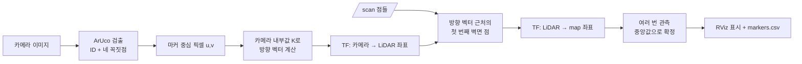

<div align="center">

# 🎯 osp_explorer — ArUco Marker Mapper

**TurtleBot4로 ArUco 마커를 찾아 SLAM 지도 위에 표시**

운영체제의 실제 (OSP) 기말 프로젝트 · 6조


</div>

---

## 📌 한눈에 보기

> SLAM으로 지도를 만드는 동안 카메라에 ArUco 마커가 보이면,
> **마커 ID와 지도 위 위치(x, y)** 를 계산해 RViz에 띄우고 `markers.csv`로 저장합니다.

| 항목 | 내용 |
|---|---|
| 🎯 마커 사전 | `DICT_ARUCO_ORIGINAL` |
| 📷 방향 | OAK-D 카메라 이미지 |
| 📏 거리 | RPLIDAR `/scan` |
| 🗺️ 좌표 | TF로 `map` 좌표 변환 |
| 💾 출력 | RViz `/aruco_markers`, `~/osp_result/markers.csv` |

---

## 🎯 동작 방식



**① 검출** — `cv2.aruco`의 `DICT_ARUCO_ORIGINAL` 사전으로 이미지에서 마커 ID와 네 꼭짓점을 찾습니다. (`process_period` 0.2초마다 1장 처리)

**② 방향** — 네 꼭짓점 평균으로 마커 중심 픽셀 `(u, v)`를 구하고, `/camera_info`의 내부값(fx, fy, cx, cy)으로 카메라에서 마커를 향하는 방향을 계산합니다.
```
방향 = [(u - cx) / fx,  (v - cy) / fy,  1]
```

**③ 거리** — 이 방향을 TF로 LiDAR 좌표계로 옮긴 뒤, `/scan` 점들 중 그 방향 선 근처(멀어질수록 허용 폭이 조금 넓어짐)에 있는 점을 고릅니다. 가장 가까운 면의 점들 중앙값을 마커 위치로 씁니다.

> 💡 **마커 크기를 몰라도 되는 이유**
> 거리는 카메라가 아니라 LiDAR로 잽니다. 마커가 붙은 면은 바닥까지 이어져 있어 2D LiDAR에 잡힙니다.

**④ 지도 좌표** — LiDAR 기준 점을 TF(`map ← laser`)로 map 좌표 `(x, y)`로 바꿉니다.

**⑤ 확정** — 같은 ID가 `min_detections`(3)번 이상 보이면 최근 30개 관측의 중앙값으로 위치를 확정합니다. 한두 번 튀는 값은 중앙값이 걸러줍니다.

**⑥ 출력**
- RViz `/aruco_markers`: 빨간 구 + `ID n` 글자 (1초마다 갱신)
- `/aruco_found_count`: 지금까지 찾은 마커 개수
- `~/osp_result/markers.csv`: `id,x,y`

---

## ⚙️ 설치

```bash
mkdir -p ~/osp_ws/src && cd ~/osp_ws/src
git clone https://github.com/DAEDUN/OSP_EXPLORER.git osp_explorer
cd ~/osp_ws
colcon build --symlink-install
source install/setup.bash
```

OpenCV ArUco 확인:
```bash
python3 -c "import cv2; print(cv2.aruco)"
```

---

## 🚀 실행

로봇 연결 후, 터미널 4개 (각각 `source ~/osp_ws/install/setup.bash`)

```bash
# 1️⃣ SLAM
ros2 launch turtlebot4_navigation slam.launch.py

# 2️⃣ RViz  (Add → By topic → /aruco_markers 추가)
ros2 launch turtlebot4_viz view_navigation.launch.py

# 3️⃣ 마커 매퍼
ros2 run osp_explorer marker_mapper
#   또는 params.yaml 적용해서
ros2 launch osp_explorer marker.launch.py

# 4️⃣ 키보드로 로봇 움직이기 (teleop)
ros2 run teleop_twist_keyboard teleop_twist_keyboard --ros-args -p stamped:=true
```

teleop 키 (teleop 터미널을 클릭해 둔 상태에서 입력):

| 키 | 동작 |
|:-:|---|
| `i` | 앞으로 |
| `,` | 뒤로 |
| `j` / `l` | 제자리 왼쪽 / 오른쪽 회전 |
| `u` / `o` | 앞으로 가면서 왼쪽 / 오른쪽 |
| `k` | 정지 |
| `q` / `z` | 속도 올리기 / 내리기 |

> 💡 마커 인식은 천천히 움직일 때 잘 됩니다. 처음에 `z`를 몇 번 눌러 속도를 낮추세요.

로봇을 움직이면서 마커가 카메라에 보이게 하면, 3번 터미널에 `*** FOUND marker ID n` 이 뜨고 RViz 지도 위에 표시됩니다.

---

## 📂 결과물

| 파일 | 내용 |
|---|---|
| `~/osp_result/markers.csv` | `id,x,y` (map frame), 마커가 확정될 때마다 갱신 |

지도 저장:
```bash
ros2 run nav2_map_server map_saver_cli -f ~/osp_result/map
```

---

## 🎛️ 파라미터 (`config/params.yaml`)

| 파라미터 | 기본값 | 의미 |
|---|:-:|---|
| `image_topic` | `/oakd/rgb/preview/image_raw` | 카메라 이미지 |
| `camera_info_topic` | `/oakd/rgb/preview/camera_info` | 카메라 내부값 |
| `scan_topic` | `/scan` | LiDAR |
| `min_detections` | 3 | 몇 번 보여야 확정 (오검출 있으면 ↑) |
| `max_range` | 4.0 m | 이보다 먼 마커 무시 (위치 오차 크면 ↓) |
| `process_period` | 0.2 s | 이미지 처리 간격 |

---

## 📁 폴더 구조

```
osp_explorer/
├── osp_explorer/
│   ├── geometry.py        # 좌표 변환, 픽셀→방향, 방향-LiDAR 교차 (순수 함수)
│   └── marker_mapper.py   # ArUco 검출 → map 좌표 → RViz / csv
├── config/params.yaml
├── launch/marker.launch.py
└── test/test_geometry.py
```

---

## 🧪 테스트

```bash
cd ~/osp_ws/src/osp_explorer && python3 -m pytest test
```
